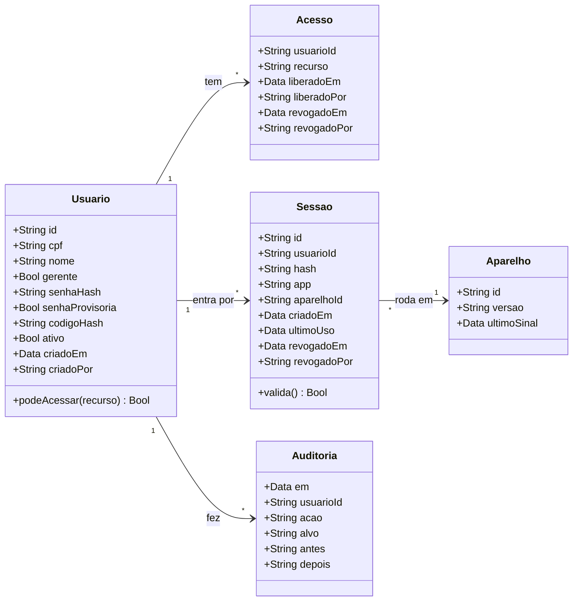
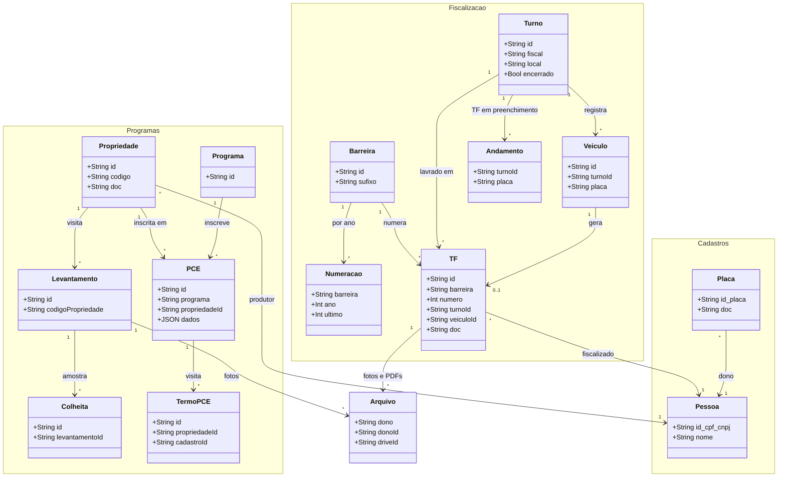
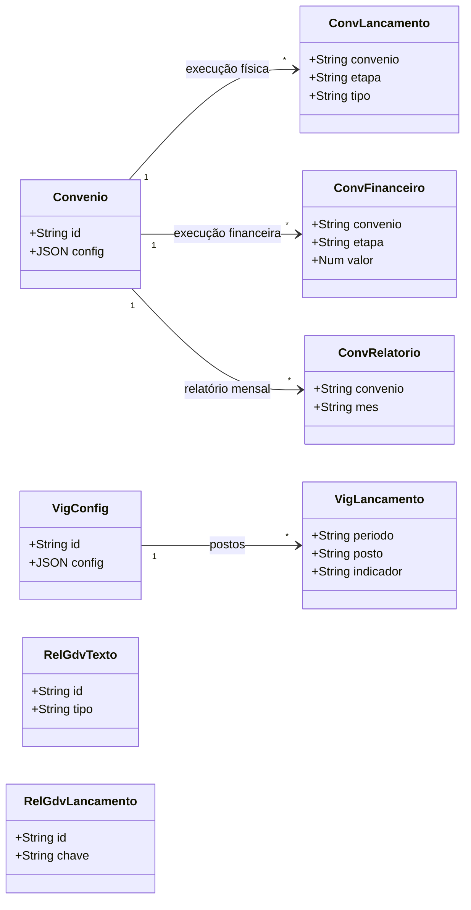

# Modelo do sistema (diagrama de classes)

Cada classe é uma aba da planilha (`TABELAS` no `Code.gs`); os atributos mostram só as chaves e os campos que ligam
uma aba à outra. Colunas completas: `TABELAS`. O GitHub desenha os diagramas (Mermaid).

## 1. Acesso (proposta, a implementar)

Decisões em [decisoes/acesso.md](decisoes/acesso.md). Substitui as abas `Fiscais`, `Permissoes`, `Administrativo` e
`AdmSessoes`, que ficam congeladas depois da migração (nada é apagado).

| Campo | Regra |
|---|---|
| `Usuario.cpf` | único (bloqueia conta duplicada), dígitos conferidos, mascarado nas telas e exportações |
| `Usuario.gerente` | 1 = acesso a tudo, inclusive ao app de campo; entra com usuário e senha |
| `Usuario.senhaHash` | só gerente; `senhaProvisoria = 1` obriga a troca no primeiro acesso (conferido no servidor) |
| `Usuario.codigoHash` | os demais: código de 6 dígitos, não expira, o gerente revoga e gera outro |
| `Acesso.recurso` | `campo`, `painel` ou `administrativo`; o dashboard é público e fica fora |
| `Sessao.app` | `campo`, `painel`, `tv` ou `administrativo`; revogar uma sessão derruba só aquele aparelho |
| `Auditoria` | toda mudança de acesso: quem, quando, o quê, antes e depois |

**A cada chamada** o servidor faz: token → `Sessao` (hash existe e não foi revogada) → `Usuario` ativo → `gerente = 1`
ou uma linha de `Acesso` com o recurso do app, sem `revogadoEm`. Falhou um passo: "sem acesso". O app de campo
funciona sem internet, então lá a checagem acontece no envio; registro de quem perdeu o acesso volta recusado.

## 2. Dados do trabalho (o que existe hoje)

`PCE` = aba `CadastrosPCE`: a ligação de uma propriedade com um programa, no máximo uma por par (o cadastro do
imóvel naquele programa; `dados` guarda os campos do programa). `Programa` não é aba: é a lista `PROGRAMAS_PCE` do
`Code.gs` (monilíase, banana, citros, mandioca, soja, propriedade). `Arquivo` liga a qualquer registro por
`dono` (nome da aba) + `donoId`. `Consultas` (registro de consultas de CPF/placa) e `Aparelhos` (sinal) ficam fora do
desenho.

## 3. Gestão (painel e Portal do Administrativo)

## Quem fez cada registro

Hoje todo registro guarda `usuario` = o **nome** digitado, e `gravar_` sobrescreve com quem sincronizou por último.
Com o acesso novo, cada aba de dados ganha `usuarioId` (coluna no fim) ligado a `Usuario.id`, e o autor fica separado
de quem editou por último (regra de rastreabilidade e LGPD).
