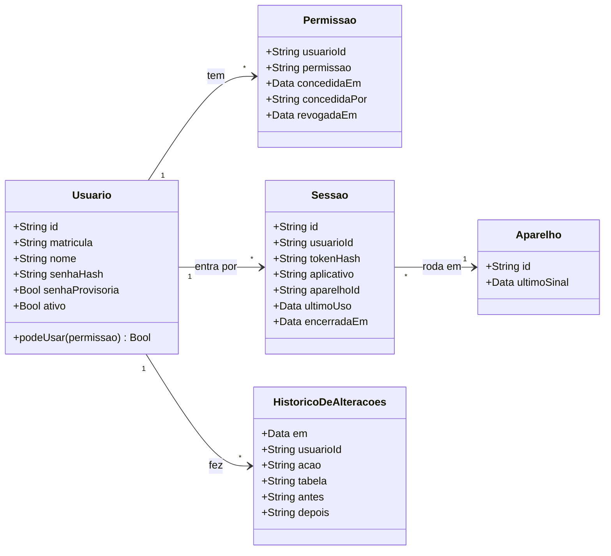
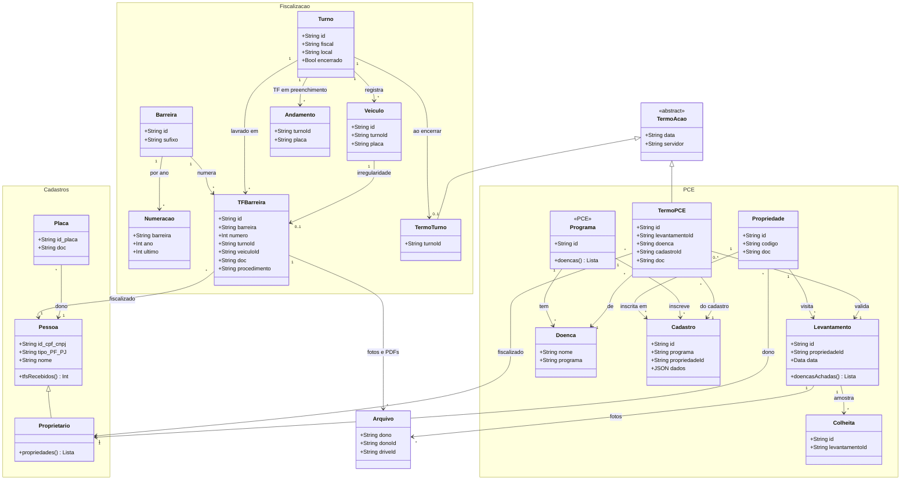
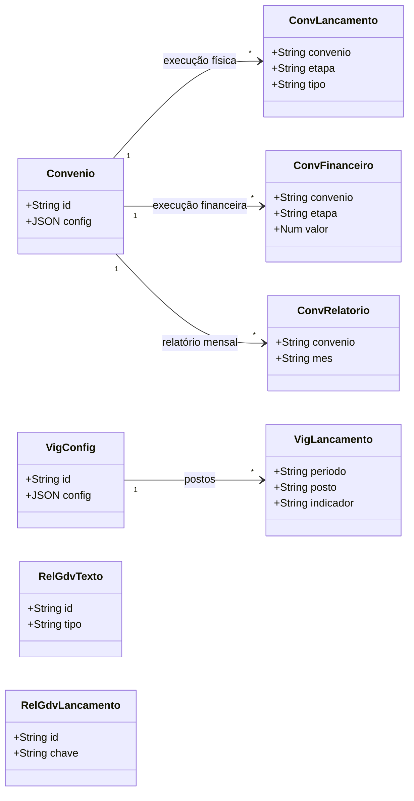

# Modelo do sistema (diagrama de classes)

Cada classe é uma aba da planilha (`TABELAS` no `Code.gs`); os atributos mostram só as chaves e os campos que ligam
uma aba à outra. Colunas completas: `TABELAS`. O GitHub desenha os diagramas (Mermaid).

## 1. Acesso (proposta, a implementar)

Decisões em [decisoes/acesso.md](decisoes/acesso.md); abas em [banco.md](banco.md).

**A cada chamada** o servidor faz: token → `Sessao` (hash existe, não encerrada) → `Usuario` ativo e sem senha
provisória pendente → `Permissao` do app ou módulo, não revogada (`gerencia` vale tudo). Falhou um passo: "sem
acesso". O app de campo funciona sem internet: lá a checagem acontece no envio, e o registro de quem perdeu o
acesso volta recusado.

## 2. Dados do trabalho (o que existe hoje)

**Dois documentos com nome parecido:**

| Documento | Quando | Template | Onde fica |
|---|---|---|---|
| TF de Barreira (`TFBarreira`) | irregularidade na barreira (liberação, apreensão, rechaço) | `web/documentos/tf.html` | aba `TFs`, numeração por barreira e ano |
| Termo de Fiscalização de ação (`TermoAcao`) | ao encerrar o turno (`TermoTurno`) ou na fiscalização de uma propriedade (`TermoPCE`) | `termo.html` (turno), `pce-termo.html` e `pce-termo-citros.html` (PCE) | turno: gerado dos dados do turno, sem aba; PCE: aba `TermosPCE` |

**Pessoa e proprietário:** todo proprietário é uma pessoa, mas nem toda pessoa é proprietária (quem só passa na
barreira é só `Pessoa`). Os dois ficam na aba `Pessoas` (id = CPF/CNPJ); proprietário é a pessoa que é `doc` de
alguma `Propriedade`. É pelo CPF/CNPJ que se conta quantos TFs uma pessoa levou (`tfsRecebidos`); a reincidência
de hoje olha só o TF de Barreira.

**PCE (modelo combinado em 22/10/2026):** o PCE é o **programa** (monilíase, citros...), com várias doenças (praga
ou doença: HLB, cancro cítrico, mosca-da-carambola...). O levantamento é a visita ao proprietário e gera **0 ou
vários** Termos de Fiscalização do PCE, **um por doença achada**; cada termo valida o levantamento daquela doença.
Visita sem doença achada = levantamento negativo, sem termo. Identificação e contagem são sempre **por doença**. **O código ainda difere:** `Levantamentos` já guarda várias pragas por visita (um cartão
e uma ficha por praga), mas `TermosPCE` tem um termo por visita com uma lista de pragas, sem apontar para o
levantamento. Decisões em
[decisoes/modelo.md](decisoes/modelo.md).

`Cadastro` = aba `CadastrosPCE`: a ligação de uma propriedade com um programa, no máximo uma por par (o cadastro do
imóvel naquele programa; `dados` guarda os campos do programa). `Programa` não é aba: é a lista `PROGRAMAS_PCE` do
`Code.gs` (monilíase, banana, citros, mandioca, soja, propriedade). `Arquivo` liga a qualquer registro por
`dono` (nome da aba) + `donoId`. `Consultas` (registro de consultas de CPF/placa) e `Aparelhos` (sinal) ficam fora do
desenho.

## 3. Gestão (painel e Portal do Administrativo)

## Quem fez cada registro

Hoje todo registro guarda `usuario` = o **nome** do login (único). Nas abas com dono, só quem gravou altera; nos
cadastros comuns (pessoas, placas, propriedades), `gravar_` ainda sobrescreve com quem sincronizou por último.
Com o acesso novo, cada aba de dados ganha `usuarioId` (coluna no fim) ligado a `Usuario.id`, e o autor fica separado
de quem editou por último (regra de rastreabilidade e LGPD).
